# TaxLens — a web-native tax workpaper

**Every number carries its proof.**

### ▶ Live app: [taxlens-nithish.vercel.app](https://taxlens-nithish.vercel.app) — public, no sign-in

A working prototype for the MiraFlores AI case study *Redesign the Tax Workpaper*, built on the Okafor-Lindqvist 2025 packet (married filing jointly, Form 1040 plus a part-year California 540NR).

Click any amount and you see how it was built, the exact field on the document page it came from (highlighted), who verified it and how, what changed it and why, and what is still open about it. Under the screens, the workpaper is an append-only activity log, so undo, "what changed since I last looked", sign-offs that reopen, filing, amending and answering a notice years later all come from one mechanism.

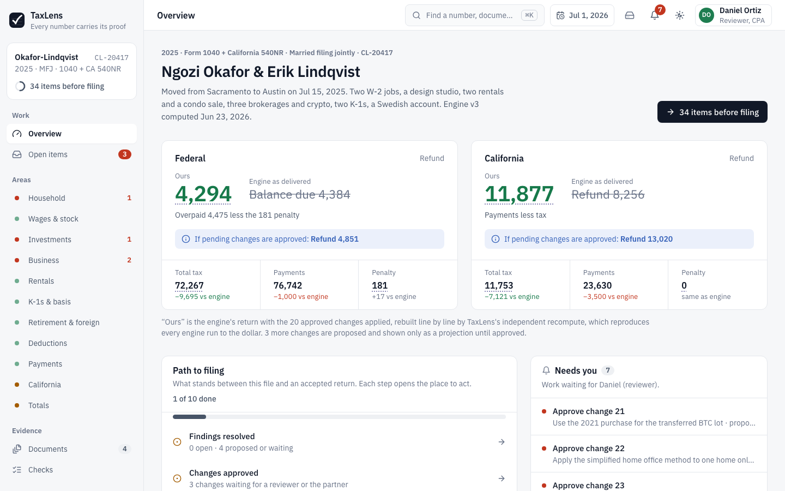

- **The idea and the data model, on one page:** [docs/ONE-PAGER.md](docs/ONE-PAGER.md)
- **Errors found, and how the design surfaced each one:** [docs/ERRORS.md](docs/ERRORS.md)
- **How AI was used:** [docs/AI-USAGE.md](docs/AI-USAGE.md)

## What it found

The engine's arithmetic is right; its inputs and a few of its rules are not. TaxLens's independent recompute reproduces all three engine runs and all five engine what-ifs to the dollar, which is what lets it recompute the corrected return exactly instead of estimating it.

| | Engine as delivered | After the corrections |
|---|---:|---:|
| Federal total tax | 81,962 | **71,710** |
| Federal result | owes 4,220 + 164 penalty | **refund 4,851** (overpaid 5,032 less a 181 penalty) |
| California total tax | 18,874 | **10,610** |
| California result | refund 8,256 | **refund 13,020** |

23 corrections (18 change tax, 2 change payments, and 3 correct data that would have caused an e-file rejection or a wrong Form 2441), plus the judgment calls, outside filings and client follow-ups a CPA needs to close. See [docs/ERRORS.md](docs/ERRORS.md).

## Screens

Screenshots from the live app, with the recorded season loaded (you are Daniel, the reviewer, on July 1, 2026).

### Welcome
Two ways in: start the file fresh as Priya (preparer), or load the four-month recorded season as Daniel (reviewer). The packet's size and hash are shown up front.

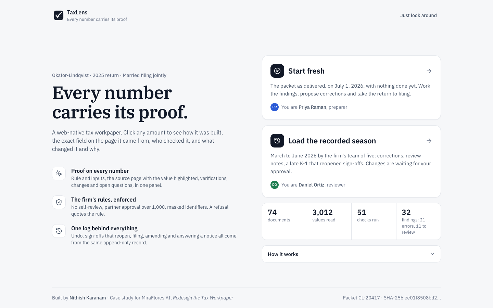

### Open items
Everything between the file and filing in one list: changes to approve, review notes, judgment calls and sign-offs. Each group folds, each row has one action, and several rows can be acted on at once with a single undo.

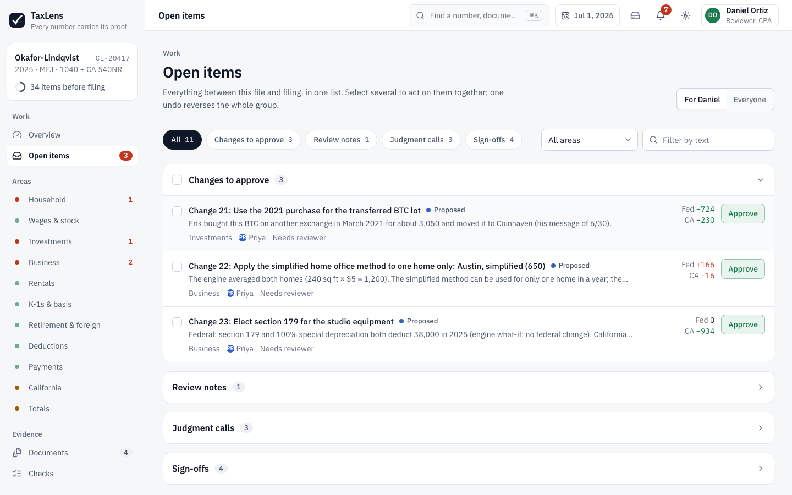

### Proof on every number
Clicking any amount opens its proof: the engine's figure, ours, the projection if pending changes are approved, and the prior year; then how it was built, engine history, verification and notes that can be handed to a named person with a due date.

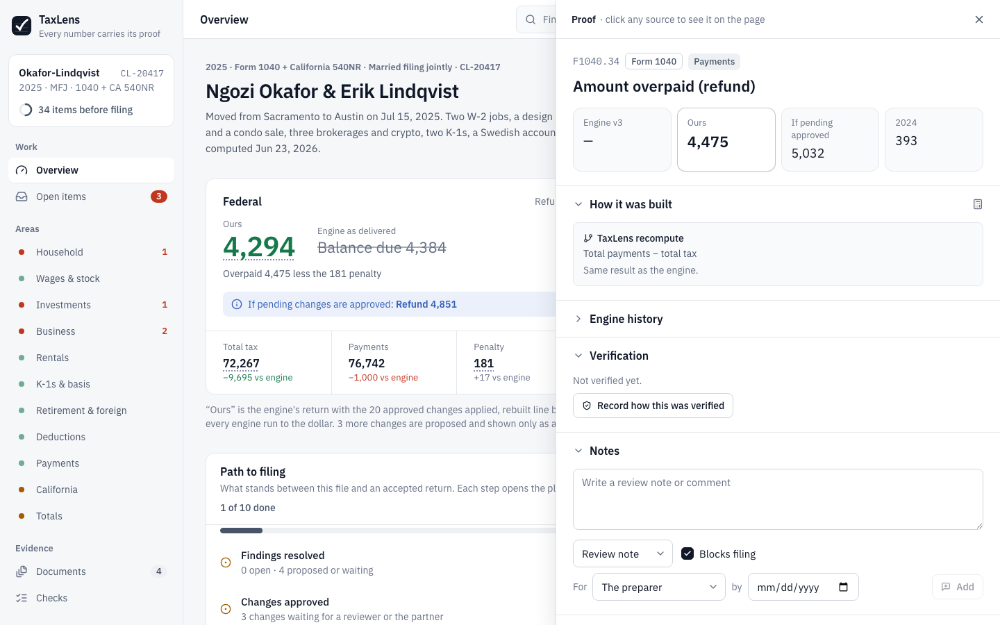

### Source document, value highlighted
Every source opens the document page with the exact field highlighted, and lists every value read from that page and which return line uses it. Identifiers stay masked unless the viewer has clearance.

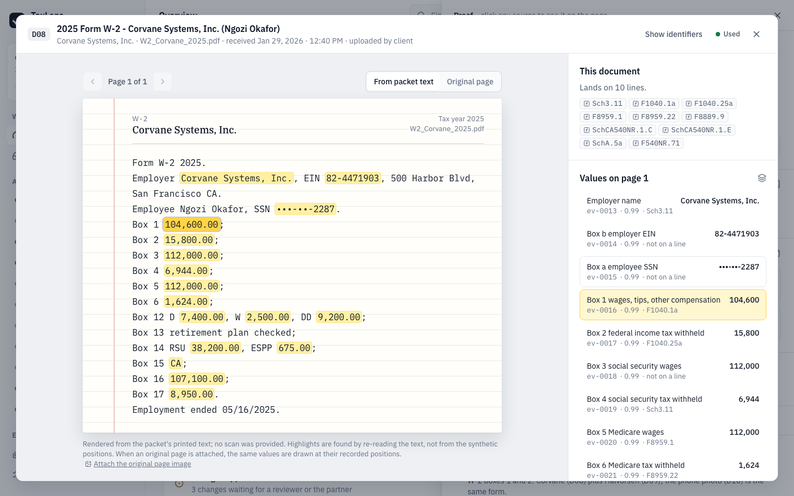

### Areas
Each area (here, the Schedule C business) shows its preparer, reviewer and partner sign-offs, its lines with the engine's figure beside ours, and its checks. A sign-off binds to the area's fingerprint and reopens when anything in it changes.

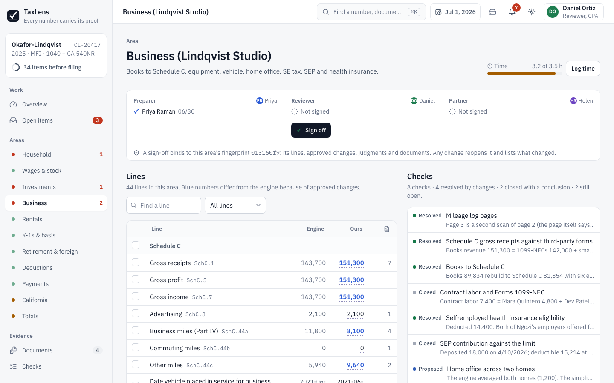

### Review and sign-off
Sign-offs by area in firm order, plus review notes, judgment calls with their authority, variances, required steps, due diligence and engine diagnostics.

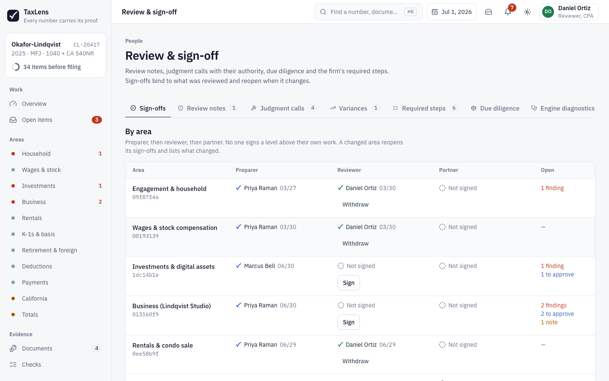

### Filing
Transmitting is refused until nothing blocks it; the page lists exactly what does. After acceptance the return freezes, later changes become an amendment, and a notice years later is answered from the frozen record.

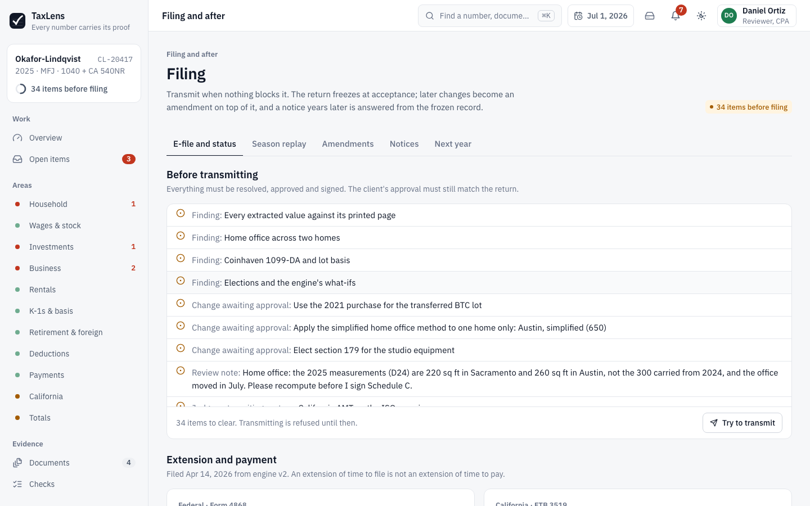

### More screens

| Changes ledger | Checks |
|---|---|
| 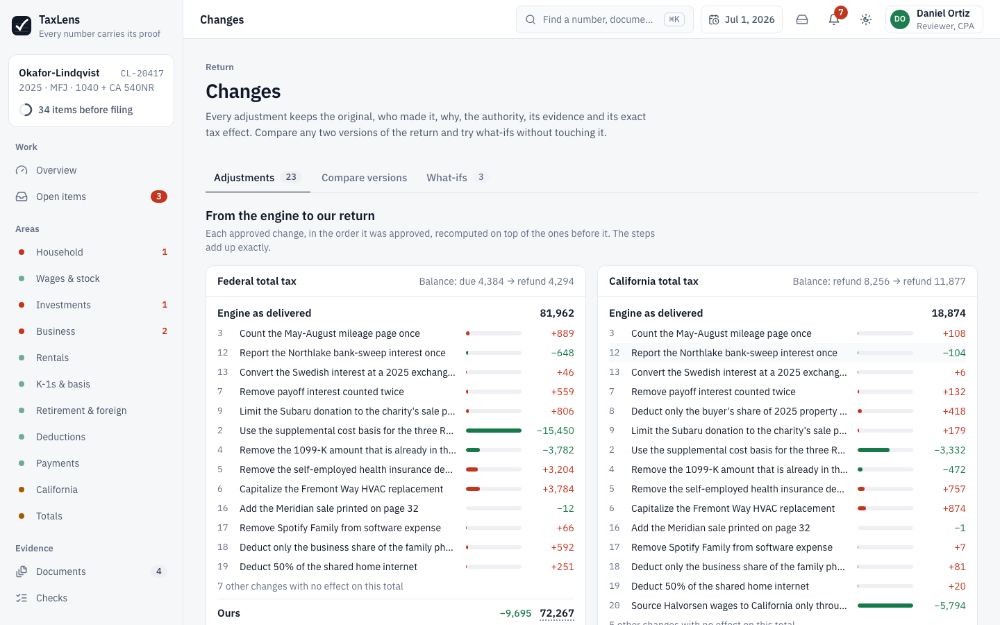 | 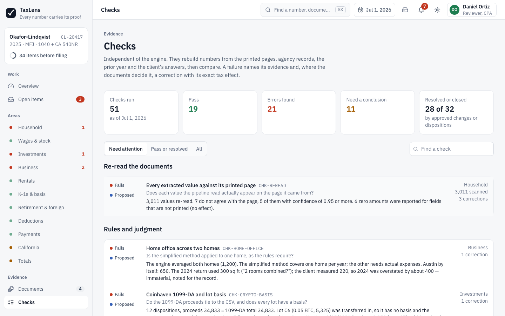 |
| **Records** | **Client portal** |
| 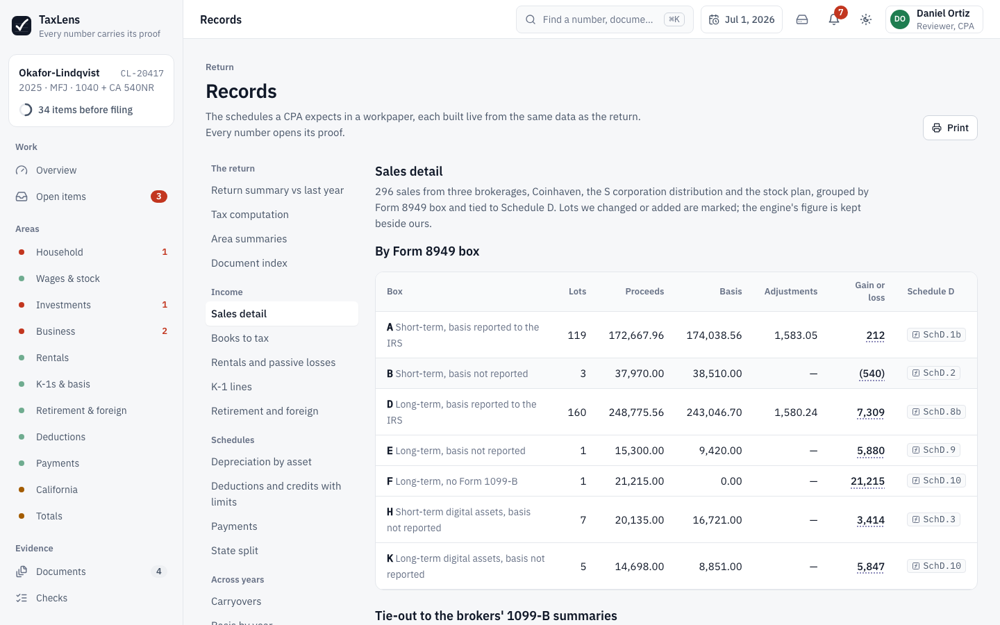 | 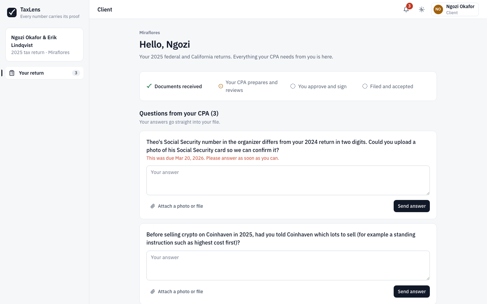 |

### Dark mode and phone

| Dark mode | Phone (390 px) | |
|---|---|---|
| 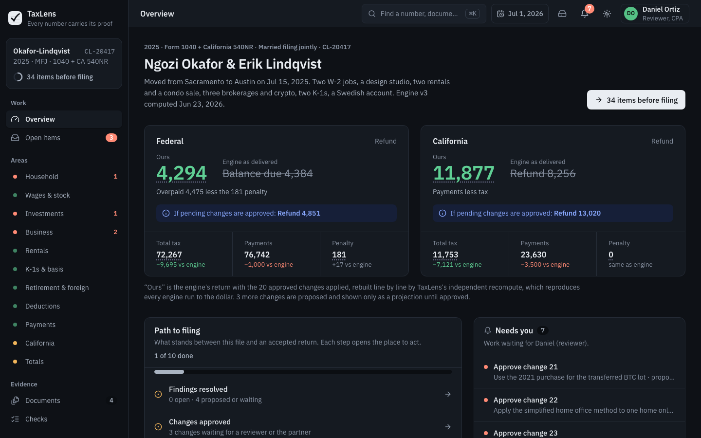 | 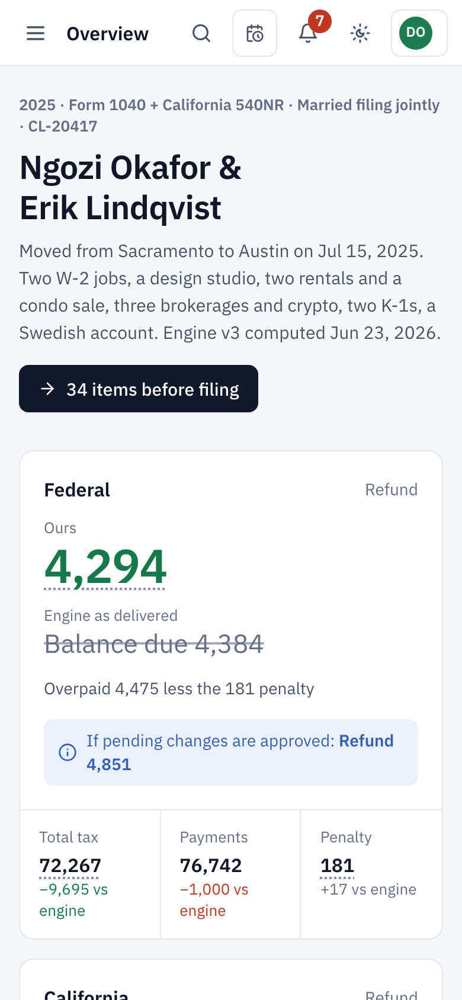 | 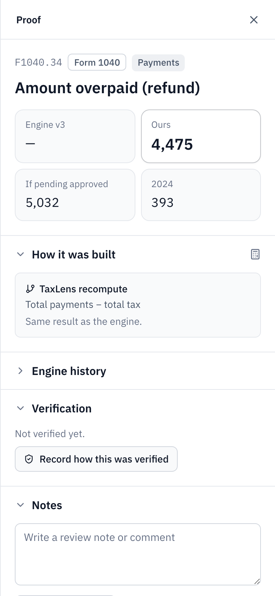 |

## Try it in five minutes

1. **Open the [live app](https://taxlens-nithish.vercel.app).** Choose *Start fresh* (you are Priya, the preparer, on July 1, 2026) or *Load the recorded season* (four months of work by five people; you are Daniel, the reviewer).
2. **Overview.** The federal and California results, the engine's figure struck through beside ours, and the path to filing. Click the refund: the proof shows how it was built.
3. **Open items → Findings.** Tick the section and choose *Propose recommended corrections*. Nothing on the return changes yet: a proposal shows its exact effect but applies only when a reviewer approves it. One undo reverses the whole group.
4. **Click any number, then one of its sources.** The document opens on the right page with the value highlighted.
5. **Roles.** Open a second browser tab and switch it to Daniel (top right). Approve the changes and watch the first tab update. A preparer cannot approve their own work, a change over 1,000 also needs the partner, and Marcus (no clearance) cannot unmask an SSN.
6. **Recorded season.** As Daniel, approve the home office change (change 22). Priya's Schedule C sign-off reopens and lists exactly which lines moved; switch to Priya and the bell tells her.
7. **Hand work to someone.** From any number's proof, write a review note *for* Marcus with a date. It appears in his Open items and his bell, shows as overdue when the season clock passes the date, and blocks filing until Daniel clears it.
8. **Filing → Season replay.** Run the rest of the packet's timeline: client approval, e-file (accepted the first time, because Theo's SSN was corrected in March), refunds, quality review, the 2026 roll-forward and the 2028 IRS letter. *Notices* builds the response package from the frozen return.

Press <kbd>/</kbd> or <kbd>⌘K</kbd> anywhere to find a number, document, check or person.

## What was done

The work came in two passes, both in this repository's history.

**1. The workpaper itself.** Packet loading and hashing, the independent recompute, 51 checks, the activity log, the firm's rules, the recorded season, the client portal, filing, amendments and notices. See *How it is built* below.

**2. A visual redesign**, so the product reads like software a tax firm would pay for, without changing any tax number, correction, check, judgment text or the recorded season. Each step was its own commit, with the build and all 39 tests passing before every push:

| Step | Commit | What changed |
|---|---|---|
| Baseline | `ae0bed8` | The app as delivered, before the redesign |
| Rename | `2962f05` | Tickmark → TaxLens in the app, logo, page title and docs (browser storage keys kept, so saved work still loads) |
| Tokens and kit | `25ba8df` | One type scale (13 to 40 px), cool neutrals, a near-black primary button, indigo only for proof links and focus, so it never looks like the preparer blue, reviewer green or partner violet that show who did the work |
| Shell | `c81e74a` | Sidebar grouped by Work, Areas, Evidence, Return, People and Filing; top bar with search, season clock and person switcher; full-screen welcome |
| Overview | `18899b8` | Results first, then what stands between the file and filing |
| Open items | `ce1e117` | Groups that fold, one action per row, clean console (a nested-button warning fixed) |
| Proof and documents | `847ce91` | Proof drawer in foldable sections with counts; document viewer with the page and its values side by side |
| Other pages | `f6a9ce0` | Areas, Records, Review, Client, Filing, Firm, Activity, Changes, Documents |
| States | `b6d36e8` | Designed loading, error, skeleton and empty states |
| Responsive | `116bd58` | Checked at 1920, 1440, 1024 and 390 px, light and dark |
| Docs | `75b1196` | Design spec as built, AI usage for the redesign pass |

The packet file (`public/packet.json`) is byte-identical to the one delivered; its SHA-256 (`ee01f850…`) is shown in the app and checked by the tests.

## Run locally

Requires Node 20 or later.

```bash
npm install
npm run dev        # http://localhost:5173
npm test           # engine, checks, season and API tests (vitest)
npm run build      # type-check and production build into dist/
```

The app is a static single page. Everything people do is saved in the browser (localStorage) and shared live between its tabs (BroadcastChannel), so two tabs are two people on the same file.

**Stack:** React 18, TypeScript, Vite 7, Tailwind CSS v4, lucide icons, Vitest. Optional shared log on a Vercel Function with Neon Postgres.

## Deploy

The live app runs on Vercel at [taxlens-nithish.vercel.app](https://taxlens-nithish.vercel.app).

**Vercel (recommended).** Import this repository in Vercel. Vercel detects Vite; no settings are needed. The app works immediately with in-browser storage. To share the link publicly, make sure *Settings → Deployment Protection → Vercel Authentication* is off.

**Shared workspaces across devices (optional).** In the Vercel project, open *Storage → Create Database → Neon (Postgres)* and connect it, which sets `DATABASE_URL`. Redeploy. The top bar then shows *Live*, and *Firm → Data* gives a workspace link: everyone who opens it works on the same activity log. Without a database, `/api/events` answers `{ db: false }` and the app stays in the browser. Tables are created on first use; rows are only ever appended.

Any static host also works (`dist/` after `npm run build`); the shared workspace is then simply absent.

## How it is built

| Layer | What it does | Where |
|---|---|---|
| Packet | Loaded exactly as delivered, validated and hashed (SHA-256). Indexes documents, pages, extracted values, engine versions, lines with their inputs, sources and consumers. Never mutated. | `src/data/` |
| Independent recompute | Rebuilds every derived line of a version from its leaf inputs and the engine's parameters (brackets, SALT cap, QBI, AMT, NIIT, CTC phase-out, passive losses, Schedule D worksheet, 2210 penalty, Schedule CA and 540NR proration). Reproduces v1, v2, v3 and every what-if exactly, so a change's effect is recomputed, not estimated. | `src/engine/recompute/` |
| Checks | 51 checks that do not trust the engine: re-read all 3,012 values against their printed pages, tie brokers to their summaries, rebuild books to Schedule C, agree payments to the IRS transcript and the FTB account, apply the rules, compare with the prior year and the client's answers. Each failure carries its evidence and, where the documents decide it, a correction. | `src/engine/checks/`, `src/engine/fixes.ts` |
| Activity log | Every action is one immutable event: propose, approve, verify, note, attach, judgment, sign-off, client approval, transmit, freeze, amend, notice response, revert. Undo appends a revert. | `src/engine/events.ts` |
| State | `fold(events up to a moment)`. Time travel, "since you last looked" and version comparison are prefixes of the log. | `src/engine/state.ts` |
| Workpaper | Derived on every change: our return (engine + approved changes), findings, document dispositions, per-area fingerprints that sign-offs bind to, variances, steps and filing blockers. | `src/engine/workpaper.ts` |
| Rules | Checked before anything is recorded; a refusal quotes the firm rule. `rules.test.ts` proves the refusals (self-review, the 1,000 partner threshold, clearance, start dates, sign-off order, blocking notes). | `src/engine/people.ts`, `src/app/actions.ts` |
| Recorded season | March to June 2026 played through the same actions and rules. The tests prove no step is refused. | `src/app/season.ts` |
| Notifications | Derived from the log, nothing stored: changes to approve, notes handed to you (with due dates), your sign-offs that reopened, client questions past their date, firm deadlines near or passed on the season clock. | `src/app/notify.ts` |
| UI | React, TypeScript, Tailwind v4 with the design tokens in `src/styles.css` and the components in `src/ui/kit.tsx`. Proof drawer, document viewer, areas, open items with bulk actions, 16 CPA records, review and sign-off, client portal, filing and replay, activity, firm settings. Household and firm labels come from the packet (`src/data/household.ts`), not from the screens. | `src/ui/` |
| Shared log (optional) | One Vercel Function on Postgres; idempotent by event id; a reset starts a new epoch and keeps the old rows. | `api/events.ts` |

## Tests

`npm test` runs 39 tests:

- **Recompute:** every numeric line of engine v1, v2 and v3, and all five what-ifs, match to the dollar.
- **Checks:** the planted errors are found; what is right passes; checks wait for documents that have not arrived.
- **Corrections:** every correction has evidence, authority and at least one option.
- **Rules:** the steps the firm's rules must refuse are refused, and the refusal names the rule: a preparer approving, anyone approving their own change, a change over 1,000 without the partner, a judgment without authority, Marcus unmasking an SSN, Sam acting before his start date, signing over open findings or out of order, filing over a blocking note, a note handed to a client or with a past due date.
- **Recorded season:** 200+ actions by six people pass the firm's rules; the six large corrections went through the partner; approving the home office change reopens the Schedule C sign-off and names the lines that moved.
- **Firm calendar:** timestamps are shown on Austin (Central) time for every viewer, so an evening upload keeps its own date in any time zone.
- **Shared log API** (against an in-process Postgres): append once and in order, cursor paging, workspace isolation, input validation, reset epochs and stale writers.

The full browser flow (fresh file → corrections → review → partner → client approval → e-file → refunds → quality review → roll-forward → IRS letter → amendment) and the rejection path (e-file rejected for Theo's SSN, corrected and accepted the next day) were also run end to end in Chromium with no console errors. After the redesign, the season flow (approving change 22 as Daniel reopens Priya's Schedule C sign-off) was rechecked in the browser.

## Tradeoffs and limits

- **Recompute scope.** The recompute covers every line this return uses. A change that would need a form the engine never produced is flagged rather than guessed.
- **Permissions are enforced in the client.** With the shared log, the next step is to validate each event's role on the server as well.
- **Simulated documents.** Pages are rendered from the packet's printed text and values are highlighted by re-reading that text. An original scan can be attached to any page; values are then drawn at the packet's recorded positions.
- **The season clock** stands in for real dates so the scripted timeline (July 2026 to January 2028) can be replayed. It only moves forward; looking back is read-only.
- **Identifiers** are masked everywhere, including inside document text; showing one needs clearance and is logged. Client PINs are never stored.

---

Built by **Nithish Karanam** · [GitHub](https://github.com/Nithishkaranam2002) · Case study for MiraFlores AI, *Redesign the Tax Workpaper*
